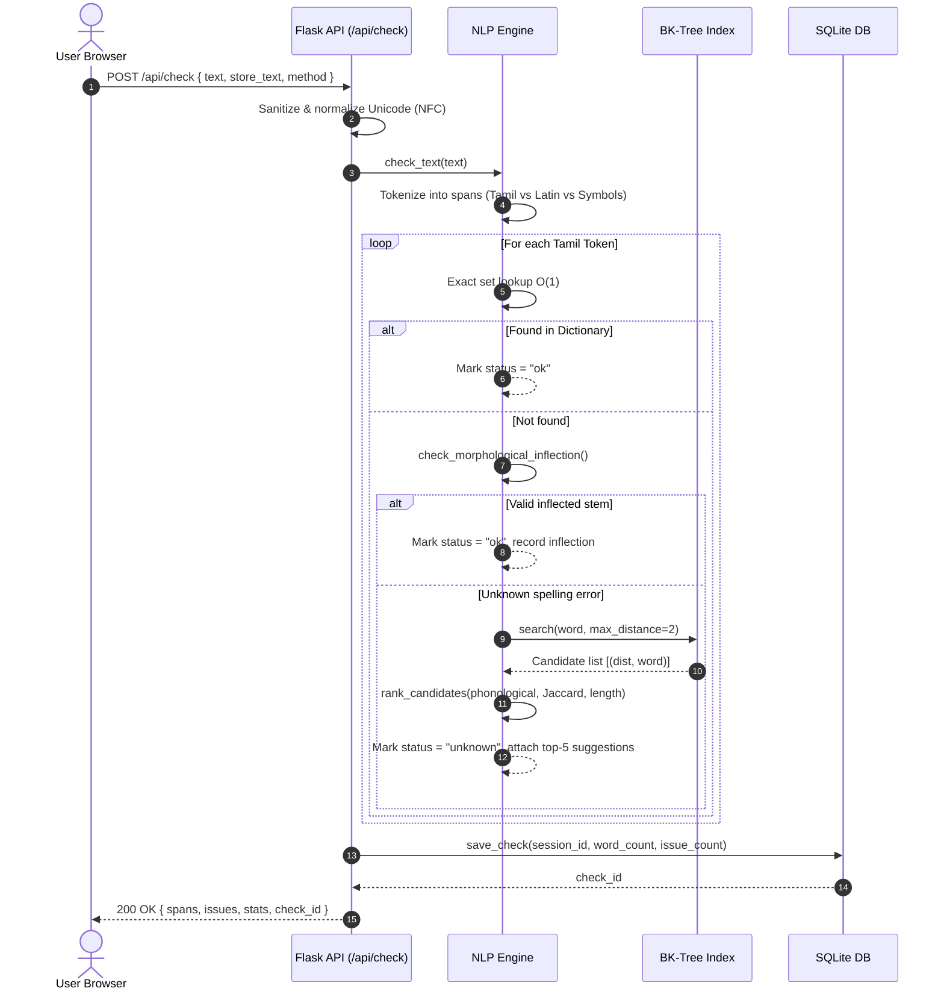
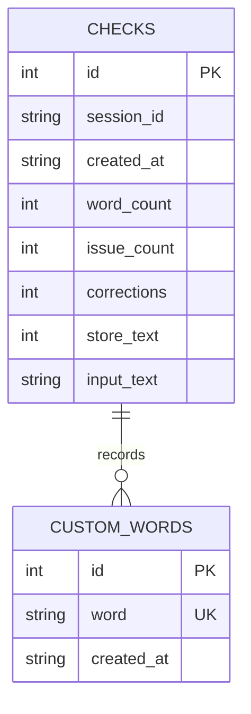

# TypeSure — System Architecture Specification

## 1. Executive Architecture Overview

**TypeSure** is an intelligent Tamil spelling detection and correction platform designed and engineered for the B.Sc. Computer Science Final-Year Project. It provides end-to-end linguistic analysis of Tamil Unicode script using discrete metric space search, phonological weighted edit distance, morphological decomposition, and deterministic client-server web protocols.

```
+-------------------------------------------------------------------------+
|                              CLIENT LAYER                               |
|   HTML5 / CSS3 (Editorial Design System) / Vanilla ES6 JavaScript       |
|   - Distraction-Free Tamil Unicode Editor                               |
|   - Real-Time Grapheme/Word/Char Counter                                |
|   - Suggestion Candidate Adoption & Recheck Interface                   |
|   - Session Storage & Local Export Tools                                |
+-------------------------------------------------------------------------+
                                    |
                                    | HTTPS / JSON (RESTful API)
                                    v
+-------------------------------------------------------------------------+
|                           APPLICATION LAYER                             |
|                           Flask WSGI / ASGI                             |
|   - Security Middleware (CSP, Strict-Transport-Security, XSS-Protect)   |
|   - Session Manager (X-Session-ID / Signed Cookie Isolation)            |
|   - Centralized Input Sanitizer & Request Validator                     |
+-------------------------------------------------------------------------+
                                    |
         +--------------------------+--------------------------+
         v                                                     v
+----------------------------------+   +----------------------------------+
|        TAMIL NLP ENGINE          |   |        PERSISTENCE LAYER         |
| - Unicode NFC Normalizer         |   | SQLite (WAL Mode) / /tmp Server  |
| - Grapheme Syllable Segmenter    |   | - checks (Session Isolated)      |
| - Morphological Suffix Analyzer  |   | - custom_words (Persistent DB)   |
| - Burkhard-Keller (BK) Tree      |   | - Automated Schema Migrations    |
| - Weighted Levenshtein Matrix    |   +----------------------------------+
| - Multi-Factor Candidate Ranker  |
+----------------------------------+
```

---

## 2. Component Architecture

### 2.1 Unicode & Grapheme Processing (`typesure.graphemes`)
Tamil characters are composed of base consonants, vowels, and diacritics. In Unicode standard U+0B80–U+0BFF:
- Standalone Vowels: $12$ codepoints (`\u0B85` – `\u0B94`)
- Aytham: $1$ codepoint (`\u0B83`)
- Consonants: $18$ primary codepoints (`\u0B95` – `\u0BB9`)
- Virama (Pulli): `\u0BCD`
- Vowel signs (Matras): $11$ codepoints (`\u0BBE` – `\u0BCC`)

A single orthographic syllable (அட்சரம்) often spans 2 or 3 Unicode codepoints (e.g., `க` + `்` = `க்`; `க` + `ி` = `கி`). 
The `split_graphemes()` engine segments words into orthographic clusters rather than raw codepoints to prevent character-level truncation and invalid edit calculations.

### 2.2 Morphological Suffix Stripper (`typesure.morphology`)
Tamil is an agglutinative language. Words regularly conjugate with case endings, postpositions, and plural suffixes.
The morphological analyzer tests candidate nominal stems against known sandhi (புணர்ச்சி) mutation patterns:
- Plural: `-கள்`, `-க்கள்`, `-ங்கள்`
- Accusative: `-ஐ`, `-யை`, `-வை`, `-த்தை`
- Instrumental: `-ஆல்`, `-யால்`, `-த்தால்`
- Dative: `-க்கு`, `-வுக்கு`, `-ுக்கு`
- Locative: `-இல்`, `-யில்`, `-த்தில்`, `-இடம்`
- Genitive: `-இன்`, `-உடைய`
- Ablative: `-இருந்து`, `-இலிருந்து`

When a token matches a valid morphological suffix whose extracted lemma exists in the dictionary, it is classified as valid without penalizing the user.

### 2.3 Metric Space Indexing (`typesure.bktree`)
The dictionary words are indexed into an in-memory **Burkhard-Keller (BK) Tree**. Because Levenshtein distance fulfills all metric space axioms (non-negativity, identity, symmetry, and triangle inequality), searching within edit radius $k$ prunes branches outside $[d - k, d + k]$, providing sub-linear retrieval latency.

### 2.4 Multi-Factor Candidate Ranking (`typesure.ranking`)
Retrieved candidates are ranked using a multi-term scoring objective function:
$$\text{Score}(q, c) = w_1 \cdot \frac{d_{\text{edit}}(q, c)}{3.0} + w_2 \cdot \frac{d_{\text{phon}}(q, c)}{3.0} + w_3 \cdot d_{\text{Jaccard}}(q, c) + w_4 \cdot \frac{|\text{len}(q) - \text{len}(c)|}{\max(\text{len}(q), \text{len}(c))}$$

---

## 3. Sequence Flow Diagram



---

## 4. Database Entity-Relationship Diagram



---

## 5. Security & Isolation Model

1. **Client Isolation**: Client requests identify via the `X-Session-ID` header or `typesure_session` cookie. SQL queries enforce `WHERE session_id = ?` boundaries so individual histories remain isolated across distinct browser sessions.
2. **Zero Text Leaks**: By default, `store_text = 0` and the input text is never saved to disk. Only aggregate token counts are committed unless the user explicitly toggles the opt-in checkbox.
3. **Content Security Policy (CSP)**: Outbound responses enforce `default-src 'self'`, restricting script execution to origin-hosted scripts and preventing remote script injection.
